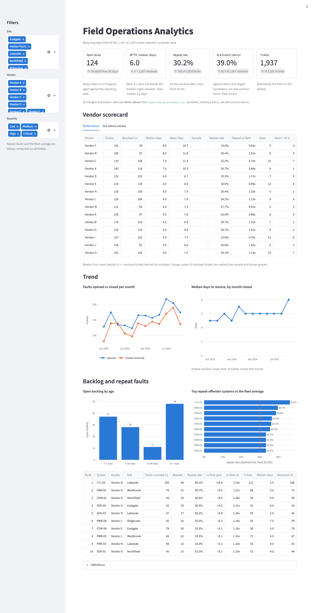
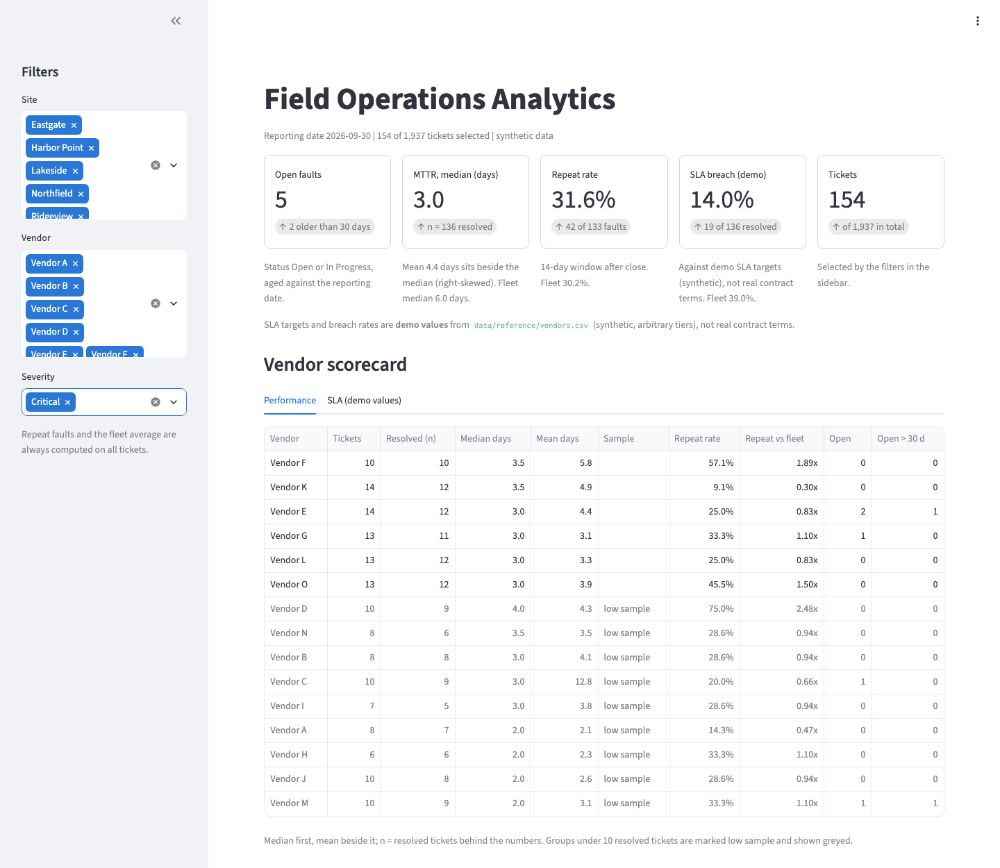
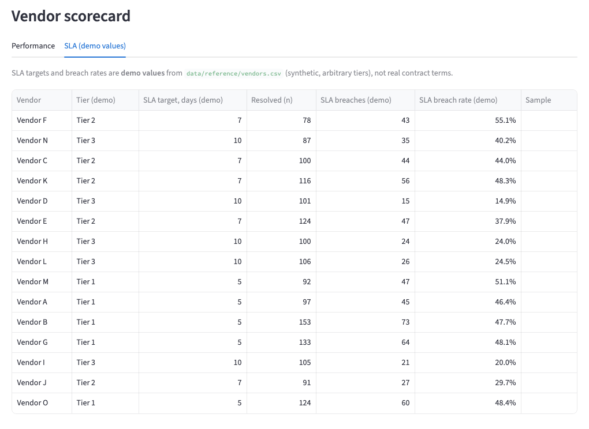
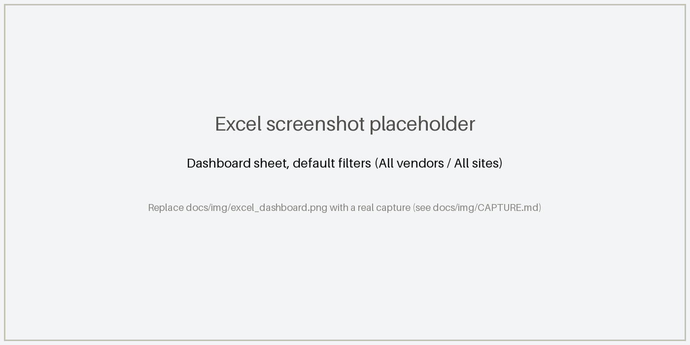
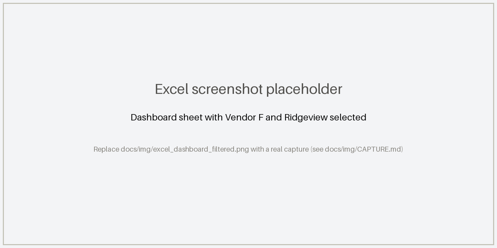
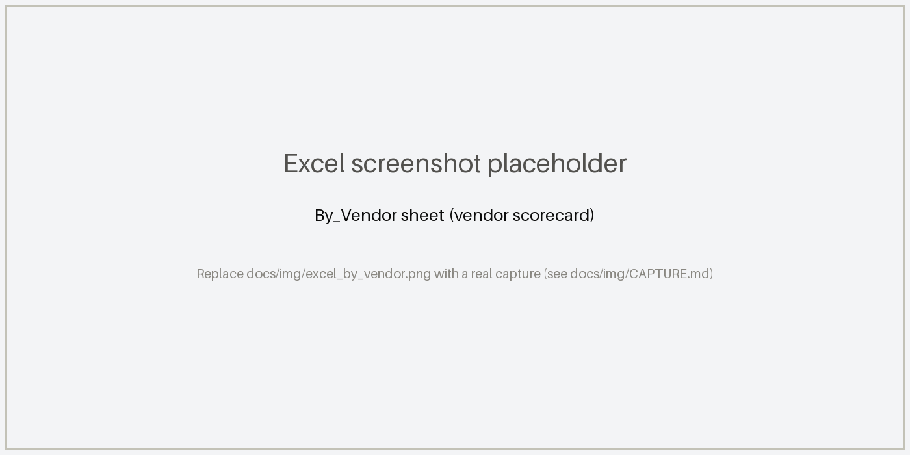
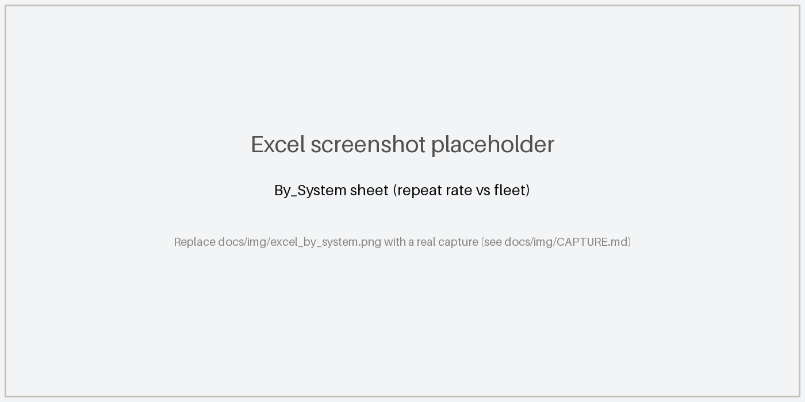
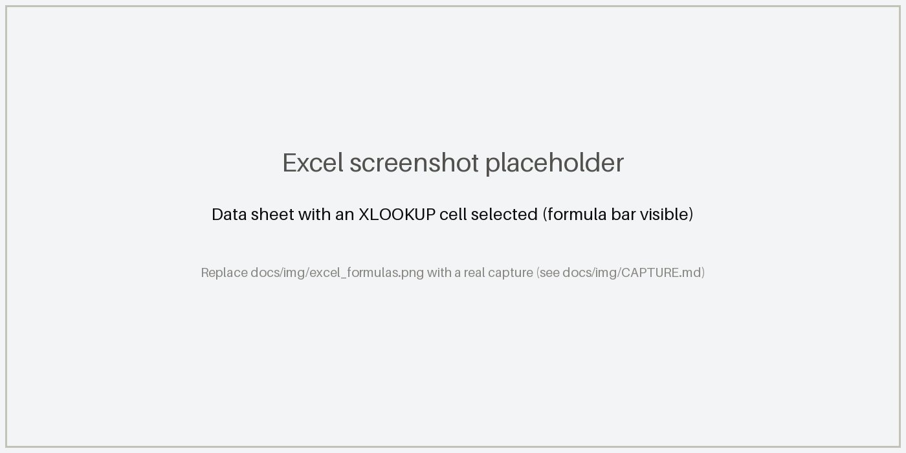
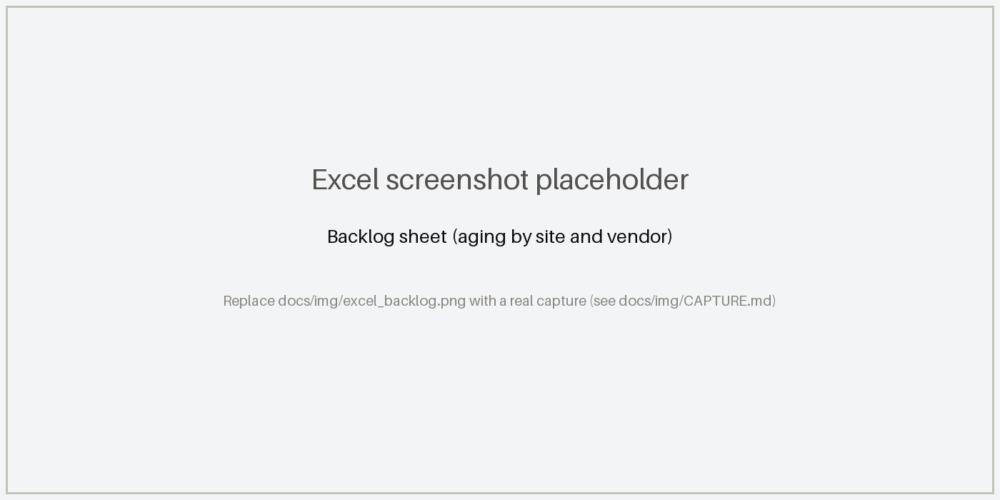
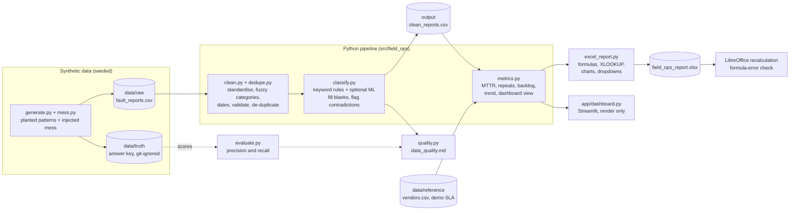

# Field Operations Analytics

> **Synthetic data, demo values.** Every record in this repository is generated by code
> (`src/field_ops/generate.py`, fixed seed). Nothing here comes from a real organisation or
> system. The vendor tiers, SLA targets, regions and contract types in
> `data/reference/vendors.csv` are arbitrary demo values, and every finding below describes this
> synthetic dataset only.

An end-to-end analytics project: take messy multi-vendor field fault reports, clean them, and show
which faults repeat, how long they take to resolve, and which vendors and systems perform worst.
One Python pipeline produces a clean dataset, a formula-driven Excel report and a Streamlit
dashboard, all reading the same metrics module so the numbers cannot disagree.

## The problem

Fault reports from multi-vendor field operations are messy and scattered. The same vendor appears
under five spellings, categories are typed by hand, dates arrive in mixed formats, tickets are
re-entered or exported twice, close dates go missing, and the free-text description is where the
real story lives: often vague, sometimes naming two problems, occasionally contradicting the
category someone picked.

Three questions get lost in that mess:

1. Which faults keep coming back?
2. How long do they take to resolve?
3. Which vendors and systems perform worst?

## What it does

| Step | What happens | Code |
|---|---|---|
| Generate | A seeded generator simulates a year of reports (2,075 raw rows) with injected mess and a few planted patterns. The answer key is written to a separate, git-ignored folder, never into the raw file. | `generate.py`, `mess.py` |
| Clean | Standardise vendors (pattern only, never fuzzy), categories and sites (alias table plus fuzzy typo matching), dates (five formats), reporters; validate; remove exact and near duplicates. Every fix is counted. | `clean.py`, `dedupe.py` |
| Classify | Fill *blank* categories from the description with keyword rules (an optional ML model runs alongside). A logged category is never overwritten; contradictions are flagged for review. Vague text stays `Unclassified`. | `classify.py` |
| Measure | Median-first resolution time, repeat faults, aged backlog, monthly trend, vendor scorecard, with n and low-sample flags. | `metrics.py` |
| Report | An Excel workbook built from real formulas, and a Streamlit dashboard that only renders `metrics.dashboard()`. | `excel_report.py`, `app/dashboard.py` |
| Check | Every Excel summary cell is recalculated in LibreOffice and compared with pandas; CI fails on any formula error. | `libreoffice.py`, `tests/` |

## Screenshots

### Dashboard



A selection that makes groups small (severity = Critical): vendors under 10 resolved tickets are
flagged and greyed, so a 75% repeat rate over a handful of faults is not mistaken for a finding.



SLA numbers are always labelled as demo values:



### Excel report

<!-- The grey placeholders are replaced by real captures: see docs/img/CAPTURE.md -->








## Architecture



The clean CSV is the contract: metrics, the Excel report and the dashboard all start from it.
`evaluate.py` is the only code that reads the answer key, and the cleaning code never does.

## Key numbers (synthetic dataset)

| | |
|---|---|
| Raw rows to tickets | 2,075 raw rows, 80 exact duplicates and 58 re-entered tickets removed, **1,937 tickets** |
| Resolved / open | 1,607 resolved; 124 open, of which 59 are older than 30 days |
| Resolution time | median **6.0 days**, mean 8.1 days (median first: the distribution is right-skewed) |
| Repeat rate | **30.2%** with a 14-day window (20.4% at 7 days, 41.4% at 30 days) |
| SLA breach (demo targets) | **39.0%** of resolved tickets, against the demo targets only |

## What the data shows

The generator plants a few patterns so the analysis has something to find. Part of the exercise
is checking how many of them the metrics actually recover (see the findings below).

- **Cleaning.** About 8% of reports had no category. 138 were filled from the description text
  and 13 were left `Unclassified` because the text was too vague; 93 logged categories
  contradict their own description and are flagged, never changed.
- **One site holds the aged backlog.** Ridgeview has 20 open tickets older than 30 days; the next
  site has 11. The typical open ticket there is 99 days old.
- **Volume peaks in summer.** July and August average about 210 new reports a month against 161
  over the year, about 30% higher.
- **Resolution time.** Vendors F and N have a median of 8 days against 5 to 6 for most others.
  Vendor C looks different: a median of 7 but a mean of 11.3, a long tail rather than
  across-the-board slowness.
- **The window matters.** The repeat rate moves from 20% to 41% depending on whether a repeat
  must follow within 7 or 30 days, which is why the choice is configurable and the sensitivity is
  shown in the report.

## Limitations and findings

Honest results, including the ones that did not work.

- **Classification: simple rules beat the ML model, and both fall apart off-template.** On the
  generated data the keyword rules score close to 100%, but that is not a fair test: the same
  author wrote the rules and the text templates. On a separate hand-written challenge set of 66
  descriptions the rules scored **59%** (39 of 66: one confident wrong answer, 26 safe
  abstentions) and the TF-IDF + logistic-regression model **42%** (28 of 66: four wrong, 34
  abstentions). The set is small and authored by me, so treat each figure as roughly plus or minus
  12 points. The model was trained only on the generator's templated text, which is the likely
  reason it generalises worse. These figures moved slightly when the vocabulary of the synthetic
  data was made neutral: an earlier version of the set scored 58% and 33%. The challenge set and
  the rules' keyword lists were rewritten once for the new wording and not tuned afterwards, so
  the shift (rules up 1 point, model up 9) is within the noise of a 66-item set; what did not
  change is the ordering, rules ahead of the model.
- **The repeat metric is sensitive but not specific.** With about 59 tickets per system a year, a
  same-category fault lands inside a 14-day window by chance most of the time. Measured against
  the generator's answer key, the metric finds about half of the planted recurrences, and about
  85% of what it flags is coincidence. (That check is only possible because the data is
  synthetic.) On real data the rate would need a chance baseline before it is trusted.
- **Vendor resolution-time gaps are modest.** The slowest vendors sit 2 to 3 days above the rest on
  the median, with heavily overlapping distributions; Vendor K, one of the planted slow vendors, has
  the same median (7 days) as Vendor C, which was planted only for a long tail. Medians are in
  whole days, which blunts the comparison.
- **The failure-prone-system pattern was not recovered.** The generator plants five systems with
  extra repeat faults. Only 2 of them reach the top 5 by repeat rate (the others rank 7th, 14th
  and 16th). The test records this as an expected failure instead of tuning the generator.
- **Other limits.** One seed and one dataset; text is templated; slash dates are read as
  DD/MM/YYYY (276 rows are ambiguous); 178 faults are left out of the repeat metric because the
  previous fault was closed with no close date; fuzzy matches scoring 80 to 85 are flagged for
  review but none occur in this data; and the Excel workbook is verified by LibreOffice
  recalculation and by comparison with pandas, not by running desktop Excel in CI.

## How to run

You need `make` and [uv](https://docs.astral.sh/uv/) (it installs Python 3.12). LibreOffice 24.8
or newer is needed for the Excel formula check (XLOOKUP): CI installs it, and locally the check
is skipped with a message if it is missing.

```bash
make all          # generate, clean, classify, metrics, Excel, formula check, lint, tests
make dashboard    # open the Streamlit dashboard
make screenshots  # re-take the dashboard screenshots (dev tool: installs Chromium)
```

`make all` writes to `output/`: `clean_reports.csv`, `data_quality.md`, `metrics_report.md`,
`metrics/*.csv` and `field_ops_report.xlsx`. Individual steps:

```bash
uv run field-ops generate | clean | metrics | excel | verify-excel | all
uv run field-ops metrics --repeat-window 7     # change the repeat window (default 14 days)
```

## Design decisions

- **Vendors are matched by pattern, never by similarity.** "Vendor A" and "Vendor B" differ by one
  character, so a similarity score cannot tell a typo from a different vendor. Unparseable values
  become `Unknown` with a recorded reason. Fuzzy matching is limited to categories and sites.
- **A logged category is never overwritten.** Text fills blanks and raises a flag for review.
  Text with no clear signal stays `Unclassified` instead of being guessed.
- **Median first, with n.** Resolution times are right-skewed. Groups under 10 resolved tickets are
  marked low-sample and are never ranked.
- **Repeat flags are computed on all tickets, then filtered.** Whether a fault is a repeat depends
  on the previous fault, which a filter may hide.
- **One source of business logic.** Excel and the dashboard consume `metrics.py`; a test inspects the
  app's source and fails if it calculates anything itself.
- **Real formulas.** Conditional medians are array formulas (`AGGREGATE` with an inline array
  fails in LibreOffice); vendor tier and SLA are joined with `XLOOKUP`. The repeat flags come from
  Python because the rule needs the previous ticket, and the workbook says so.
- **The answer key lives apart from the data.** It is used only to score the cleaning,
  classification and metrics, never to build them.
- **Tests that can fail.** Scorers, the formula-error check and the no-business-logic check each
  have a test that breaks them on purpose.

## Repository layout

```
src/field_ops/   generate, mess, clean, dedupe, classify, metrics, quality, evaluate,
                 excel_report, libreoffice, pipeline (the `field-ops` command)
app/             Streamlit dashboard
scripts/         screenshots.py (dev tool)
data/reference/  vendors.csv (demo values), challenge_descriptions.csv (hand-written test set)
tests/           about 240 tests, including Excel-vs-pandas agreement via LibreOffice
docs/img/        screenshots (Excel captures: see docs/img/CAPTURE.md)
.github/         CI: pipeline, LibreOffice formula check, lint, tests
```

## Tests and CI

`make all` ends with ruff and pytest. CI installs LibreOffice, runs the whole pipeline, recalculates
the generated workbook and fails on any formula error, then runs lint and the tests. The LibreOffice
version is printed at the start of the formula check and of the test run.
